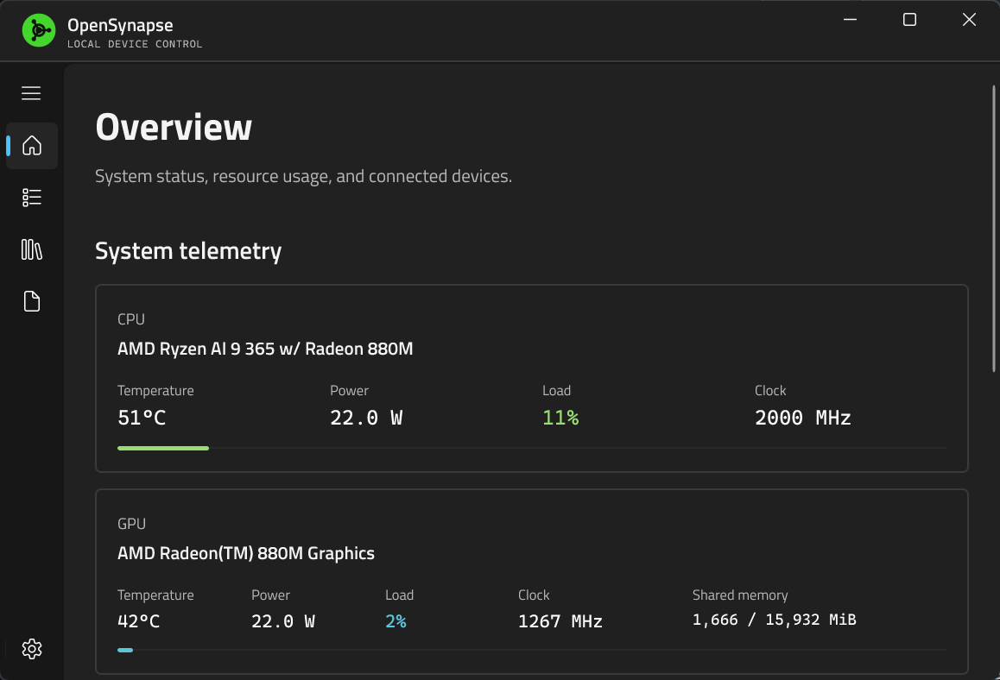
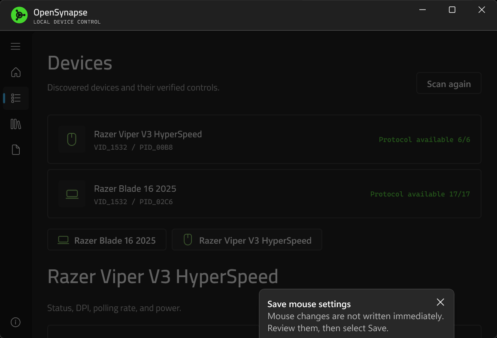
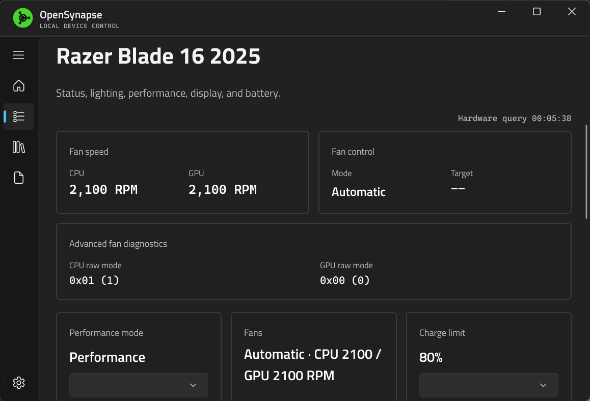
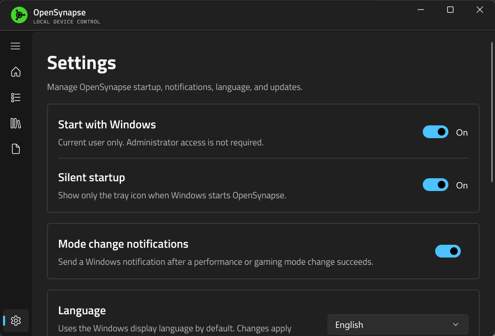

<p align="center">
  
</p>

<h1 align="center">OpenSynapse</h1>

<p align="center">Control supported Razer hardware on Windows 11 without keeping Razer Synapse open.</p>

<p align="center">
  <a href="https://github.com/A1mAssist/OpenSynapse/releases/latest"></a>
  <a href="LICENSE"></a>
  
</p>

<p align="center"><a href="README.zh-CN.md">简体中文</a> · English</p>

OpenSynapse reads connected devices first, then exposes only the controls resolved for that exact USB device and HID endpoint. It supports 254 OpenRazer catalog models plus dedicated Blade/Viper, Kraken, and Chroma REST integrations.

> Current release `v1.5.2` · Windows 11 x64 · unsigned

See [CHANGELOG.md](CHANGELOG.md) for release history.

## What it supports

OpenSynapse is not limited to a small list of product-specific models. The current support surface includes **254 OpenRazer catalog devices**, dedicated Blade and Viper controls, **six Kraken headsets**, and Chroma REST lighting integrations.

**[Browse the complete device and capability list](docs/SUPPORTED_DEVICES.md)** for model names, USB PIDs, product-specific features, and the exact support boundaries.

### Capability-driven controls

OpenSynapse reads connected devices first, then exposes only the controls resolved for that exact USB device and HID endpoint. Depending on the model, a device page may include device information, battery state, polling rate, DPI and DPI stages, power saving, lighting, matrix output, scroll settings, keyswitch optimization, Fn behavior, or HyperPolling receiver controls.

The pinned OpenRazer catalog covers 110 mice, 72 keyboards, 46 laptops, and 26 accessories. Catalog presence does not mean every control has been physically verified on every model. An unresolved or busy endpoint stays read only until the next scan; OpenSynapse does not guess support from a product name or send a write through an unverified HID collection.

### Product-specific and additional support

- **Blade:** telemetry, keyboard lighting, performance, fans, display, native panel mode, local dimming where supported, battery, touchpad, charge limit, and verified Fn/M3/M4/M5 behavior.
- **Blade THX audio:** spatial audio, EQ presets and bands, voice clarity, and speaker volume normalization on supported Blade 16 and Blade 14 models. The Blade device page opens a reusable THX control window. The signed Razer native component is not bundled; if missing, the app offers a verified download from Razer's official server.
- **Viper:** battery, DPI, polling, sleep timeout, battery type, and onboard mappings.
- **Kraken:** lighting only for six USB headsets; audio, microphone, EQ, and THX controls are not included.

### Chroma REST

See [Chroma-supported devices](docs/CHROMA_SUPPORTED_DEVICES.md) for the current device and transport matrix.

Compatible games and integrations can send static, `CUSTOM`, `CUSTOM_KEY`, and `CUSTOM2` keyboard frames to `127.0.0.1:54235`. Frames use the verified Blade 16 key layout, and OpenSynapse restores the selected lighting effect after external control ends. The native Chroma SDK and `RzChromaConnectAPI` DLL interface are not implemented.

## Screenshots

| Overview | Devices |
|---|---|
|  |  |

| Blade controls | Settings |
|---|---|
|  |  |

## Install

Download one of these files from [GitHub Releases](https://github.com/A1mAssist/OpenSynapse/releases/latest).

- `OpenSynapse-win-Setup.exe` installs for the current user and supports automatic updates.
- `OpenSynapse-win-Portable.zip` runs without installation.

Exit Razer Synapse before scanning devices so both applications do not contend for the same HID endpoint. OpenSynapse reports access failures and does not terminate Synapse itself.

The release is not code signed. Windows SmartScreen may show a warning on first launch.

### Driver requirements

The application does not require Razer Synapse, AppEngine, or `mapping_engine.dll` for its core device controls. Blade Fn, M3, M4, and M5 support still depends on the Product 710 Razer device drivers. THX audio requires the matching Razer THX stack and the signed native component offered by the Blade audio window.

## Not included

- Firmware updates, Razer accounts, cloud services, and Chroma Studio.
- Advanced macro editing.
- AMD Curve Optimizer, GPU MUX controls, and unverified hardware writes.
- ARGB Controller and legacy fixed-report devices whose Windows transport is unavailable.

## Build

Building requires Windows 11 x64, the [.NET 10 SDK](https://dotnet.microsoft.com/download/dotnet/10.0), and Windows SDK `10.0.26100`.

The post-v1.5.1 source/test-build controls for peripheral low-battery notifications and Chroma REST source management are documented in [Notifications and Chroma sources](docs/NOTIFICATIONS_AND_CHROMA_SOURCES.md).

```powershell
dotnet restore OpenSynapse.slnx
dotnet build OpenSynapse.slnx -c Release
dotnet test OpenSynapse.slnx -c Release --no-build
dotnet build src/OpenSynapse.App/OpenSynapse.App.csproj -c Release -p:Platform=x64
```

Run the local build with:

```powershell
& '.\src\OpenSynapse.App\bin\x64\Release\net10.0-windows10.0.26100.0\OpenSynapse.App.exe'
```

## Contributing

Read [CONTRIBUTING.md](CONTRIBUTING.md) before submitting code or documentation. Keep generated binaries, logs, captures, reverse-engineering workspaces, credentials, and machine-local configuration out of Git.

## License

OpenSynapse is available under the [MIT License](LICENSE). Third-party components and bundled resources keep their own licenses and distribution terms.

The protocol implementation references [OpenRazer](https://github.com/openrazer/openrazer), [OpenRGB](https://gitlab.com/CalcProgrammer1/OpenRGB), and other public implementations. OpenSynapse is not affiliated with or endorsed by Razer Inc. Razer and related product names are trademarks of their respective owners.

Made with ❤ in C# by [A1mAssist](https://github.com/A1mAssist).
