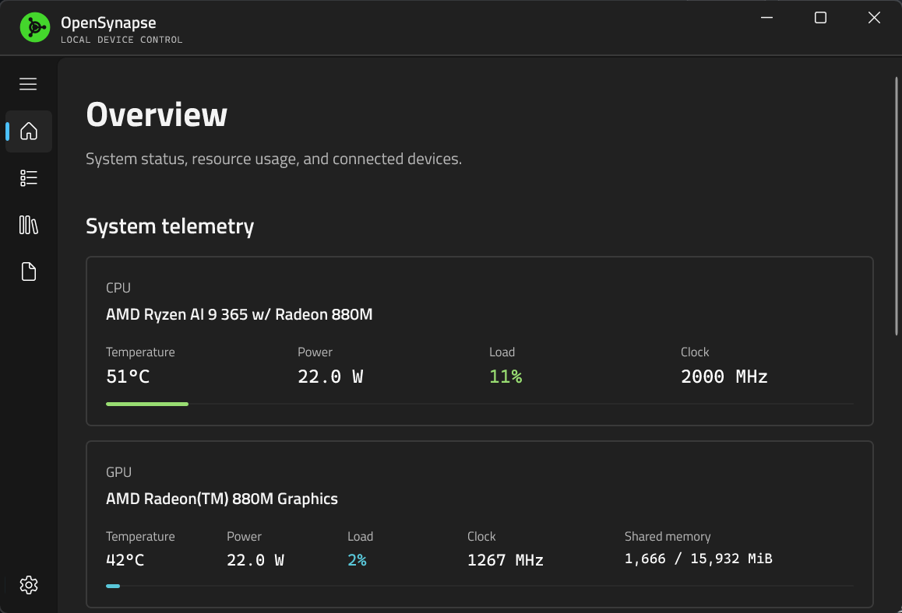
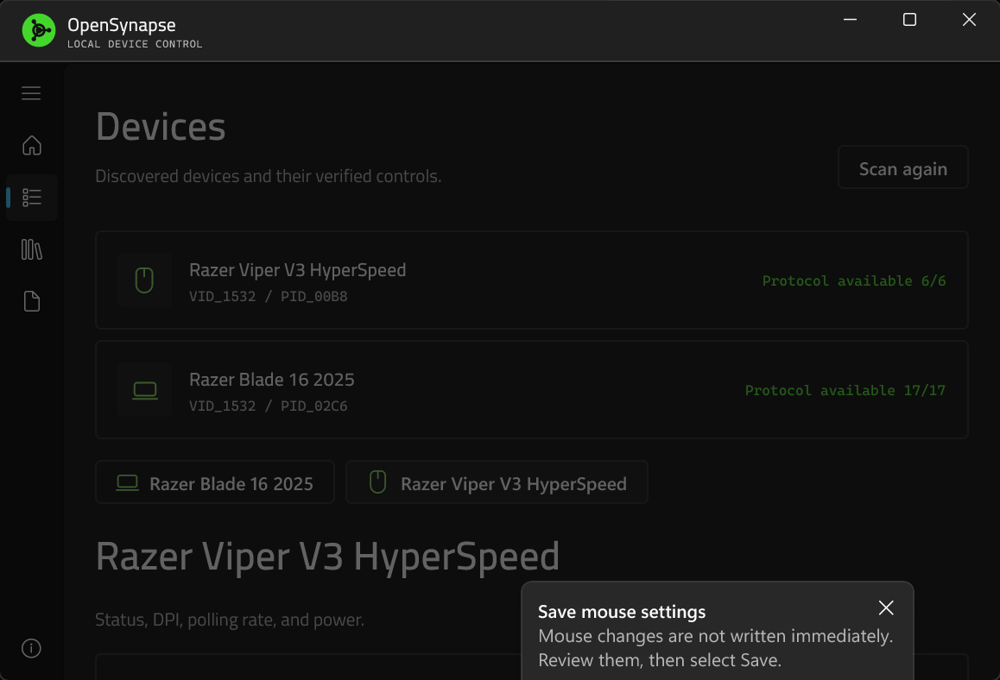
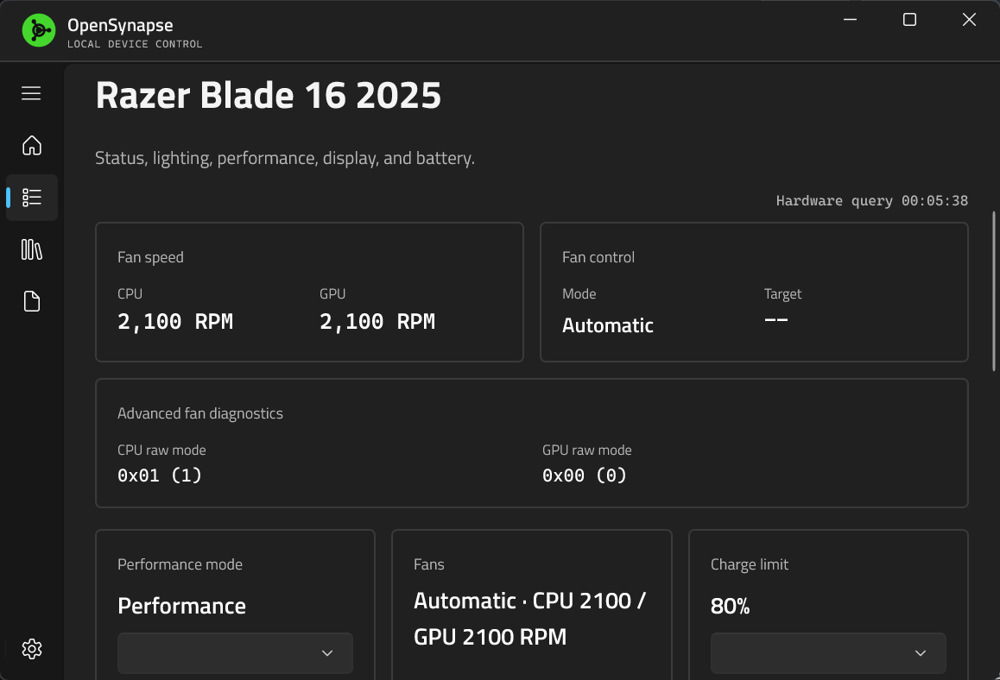
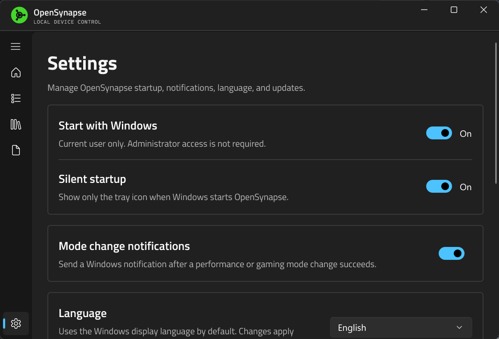

<p align="center">
  
</p>

<h1 align="center">OpenSynapse</h1>

<p align="center">Control supported Razer hardware on Windows 11 without keeping Razer Synapse open.</p>

<p align="center">
  <a href="https://github.com/A1mAssist/OpenSynapse/releases/latest"></a>
  <a href="LICENSE"></a>
  
</p>

<p align="center"><a href="README.zh-CN.md">简体中文</a> · English</p>

OpenSynapse reads connected devices first, then exposes only the controls resolved for that exact USB device and HID endpoint. It recognizes 389 device IDs across mice, keyboards, laptops, headsets, speakers, microphones, mouse pads, monitors, accessories, and network lighting.

> Current release `v1.6.0` · Windows 11 x64 · unsigned

See [CHANGELOG.md](CHANGELOG.md) for release history, or read it in [简体中文](CHANGELOG.zh-CN.md).

## What it supports

OpenSynapse is not limited to a small list of models. The current support surface covers **389 recognized device IDs**, grouped by device type: 136 mice, 96 keyboards, 50 laptops, 40 headsets, 8 speakers, 4 microphones, 8 mouse pads, 2 monitors, 44 accessories, and 1 network lighting bridge.

**[Browse the complete device and capability list](docs/SUPPORTED_DEVICES.md)** for model names, USB PIDs, controls, and the exact support boundaries.

### Capability-driven controls

OpenSynapse reads connected devices first, then exposes only the controls resolved for that exact USB device and HID endpoint. Depending on the model, a device page may include device information, battery state, polling rate, DPI and DPI stages, power saving, lighting, matrix output, scroll settings, keyswitch optimization, Fn behavior, or HyperPolling receiver controls.

The list is grouped by device type and includes every recognized PID, so a Device Manager entry can be matched directly. Presence in the list does not mean every control has been physically verified on every model. An unresolved or busy endpoint stays read only until the next scan; OpenSynapse does not guess support from a product name or send a write through an unverified HID collection.

### Controls by capability

- **Device and power:** identity, firmware, serial number, battery, charging, sleep, charge limit, and low-battery behavior when the connected endpoint exposes them.
- **Input and performance:** DPI, DPI stages, polling rate, scroll behavior, key actuation, Fn and key remapping, onboard profiles, and macro storage where the device protocol supports them.
- **Lighting:** per-zone brightness and effects, matrix output, Chroma REST, and the Chroma SDK shim. Lighting Studio adds an SVG device canvas, per-LED editing, regions, profiles, and effect composition.
- **Thermals and display:** telemetry, performance modes, fan curves, panel and GPU modes, local dimming, and touchpad controls on supported laptops. Integrated-graphics-only mode disables the discrete GPU through Windows PnP; it is not a MUX switch, and external displays may stop working until the GPU is re-enabled.
- **Audio:** EQ, microphone volume, sidetone, ANC, THX, and game/chat balance when the installed audio stack exposes them.

Controls are resolved from the connected PID and HID endpoint. A control that is absent from the current endpoint is not guessed from the product name.

### Chroma REST

See [Chroma-supported devices](docs/CHROMA_SUPPORTED_DEVICES.md) for the current device and transport matrix.

Compatible games and integrations can send static, `CUSTOM`, `CUSTOM_KEY`, and `CUSTOM2` frames to `127.0.0.1:54235` for keyboard, mouse, headset, mousepad, keypad and ChromaLink. Matrix channels use the device's own grid; whole-device channels receive the frame's average colour. ChromaLink reaches Aether lamps, docks, stands, ARGB controllers and Chroma accessories. OpenSynapse restores the effect each device had before external control. Razer Synapse is not required.

### Chroma SDK shim

The `OpenSynapse.ChromaSdk.Shim` project publishes an x64 `RzChromaSDK64.dll` that implements the Chroma SDK 4.0.1 ABI and routes effects to OpenSynapse over `\\.\pipe\OpenSynapseChromaSdk`. Keyboard, mouse, headset, mousepad, keypad and ChromaLink custom/static effects are decoded and applied to every connected device Razer's own Chroma manifest assigns to that channel. Matrix devices receive the resized frame; single-zone devices receive the frame's average colour. Generic `CreateEffect`, `QueryDevice`, and deprecated effects remain unimplemented. See [Chroma SDK shim](docs/CHROMA_SDK_SHIM.md) for the ABI evidence and deployment steps.

## Screenshots

| Overview | Devices |
|---|---|
|  |  |

| Laptop controls | Settings |
|---|---|
|  |  |

## Install

Download one of these files from [GitHub Releases](https://github.com/A1mAssist/OpenSynapse/releases/latest).

- `OpenSynapse-<version>-win-x64.msi` — **Recommended.** Installs for all users under `Program Files` and registers the GPU mode service with administrator approval. When registration succeeds, supported GPU switches use the service without another UAC prompt. If an older per-user Setup install is present, installation preserves its profiles and settings. The next unelevated launch verifies that every data file has a preserved copy, keeps conflicting versions as `.legacy-backup` files, and then removes the old install and repairs startup. Elevated launches leave the old uninstaller untouched.
- `OpenSynapse-<version>-win-Setup-AutoUpdate-PerUser.exe` — Velopack auto-update/per-user package. It installs for the current user only and does not install the machine-wide service; the GPU switch falls back to a UAC prompt for each change. Use this only when you need a per-user install or are following the auto-update path; normal installs should use the MSI.
- `OpenSynapse-<version>-win-Portable.zip` — Portable copy. It runs without installation; the GPU switch prompts for UAC when used.

`<version>` is the release version, for example `1.6.1`.

The MSI service runs as `LocalSystem` and uses the protected executable under `Program Files`. It accepts fixed status, GPU enable/disable/restart, CPU power/Curve Optimizer and GPU clock operations, plus the fixed macro-agent launch request. The control pipe allows the configured installation-user SID, local Administrators and SYSTEM, and denies network logons. Available controls remain subject to model, driver and protocol admission; failed registration can still require the existing UAC fallback.

Profiles, logs, and device manifests live in `%LOCALAPPDATA%\A1mAssist\OpenSynapse`. Keeping user data outside the Velopack-managed directory prevents an MSI upgrade or uninstall from deleting it.

Exit Razer Synapse before scanning devices so both applications do not contend for the same HID endpoint. OpenSynapse reports access failures and does not terminate Synapse itself.

The release is not code signed. Windows SmartScreen may show a warning on first launch.

### Driver requirements

The application does not require Razer Synapse, AppEngine, or `mapping_engine.dll` for its core device controls. Some laptop Fn and multimedia keys still require the matching Razer device driver, which is not redistributed. THX audio requires the matching Razer THX stack and the signed native component offered by the audio window.

## Not included

- Firmware updates, Razer accounts, cloud sync, and Chroma Studio AI color generation.
- GPU MUX modes beyond Hybrid/Discrete, and hardware writes without protocol evidence.
- Legacy fixed-report devices whose Windows transport is unavailable.

## Build

Building requires Windows 11 x64, the [.NET 10 SDK](https://dotnet.microsoft.com/download/dotnet/10.0), and Windows SDK `10.0.26100`.

The post-v1.5.1 source/test-build controls for peripheral low-battery notifications and Chroma REST source management are documented in [Notifications and Chroma sources](docs/NOTIFICATIONS_AND_CHROMA_SOURCES.md).

```powershell
dotnet restore OpenSynapse.slnx
dotnet build OpenSynapse.slnx -c Release
dotnet build src/OpenSynapse.App/OpenSynapse.App.csproj -c Release -p:Platform=x64
dotnet publish src/OpenSynapse.ChromaSdk.Shim/OpenSynapse.ChromaSdk.Shim.csproj -c Release -r win-x64 -o artifacts/chroma-sdk-shim
```

Run the local build with:

```powershell
& '.\src\OpenSynapse.App\bin\x64\Release\net10.0-windows10.0.26100.0\OpenSynapse.App.exe'
```

## Contributing

Read [CONTRIBUTING.md](CONTRIBUTING.md) before submitting code or documentation. Keep generated binaries, logs, captures, reverse-engineering workspaces, credentials, and machine-local configuration out of Git.

If you own a device that needs support, follow the [Device Adaptation Guide](docs/DEVICE_ADAPTATION.md) and use the [device support issue form](https://github.com/A1mAssist/OpenSynapse/issues/new?template=device-support.yml). Never upload Razer proprietary files or personal device data to a public issue.

## License

OpenSynapse is licensed under the [GNU Affero General Public License v3.0](LICENSE), AGPL-3.0-only. Copyright (c) 2026 A1mAssist. If you modify the program and let users interact with it over a network, those users must be offered the corresponding source. Third-party components and bundled resources keep their own licenses and distribution terms.

The protocol implementation references [OpenRazer](https://github.com/openrazer/openrazer), [OpenRGB](https://gitlab.com/CalcProgrammer1/OpenRGB), and other public implementations. OpenSynapse is not affiliated with or endorsed by Razer Inc. Razer and related product names are trademarks of their respective owners.

Made with ❤ in C# by [A1mAssist](https://github.com/A1mAssist).
