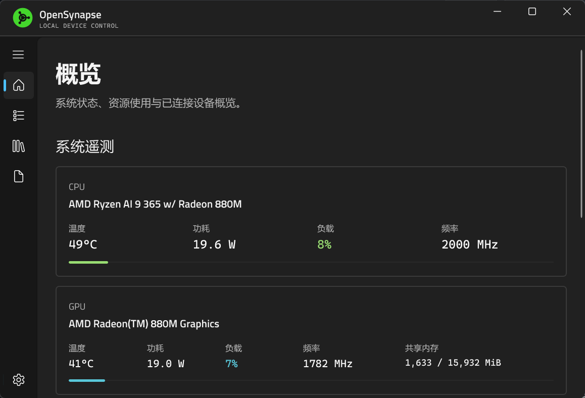
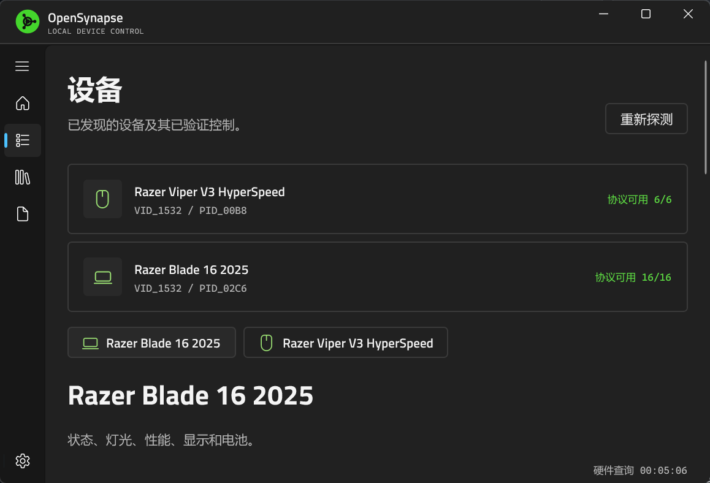
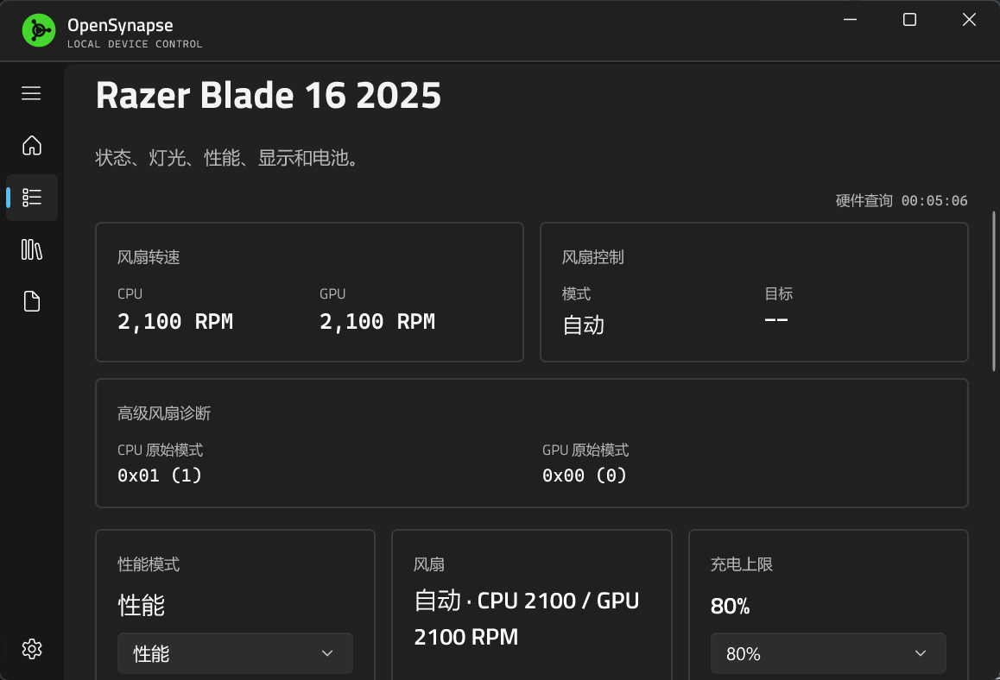
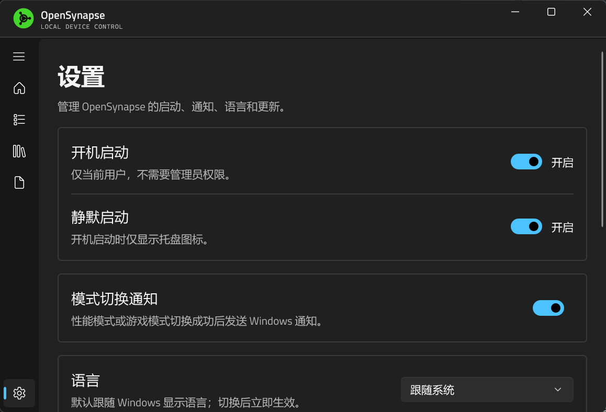

<p align="center">
  
</p>

<h1 align="center">OpenSynapse</h1>

<p align="center">在 Windows 11 上管理受支持的 Razer 硬件，不用让雷云一直留在后台。</p>

<p align="center">
  <a href="https://github.com/A1mAssist/OpenSynapse/releases/latest"></a>
  <a href="LICENSE"></a>
  
</p>

<p align="center">简体中文 · <a href="README.md">English</a></p>

OpenSynapse 会先识别已经连接的设备，再按具体 USB 设备和 HID 端点显示能够确认的控制项。当前可识别 389 个设备 ID，覆盖鼠标、键盘、笔记本、耳机、音箱、麦克风、鼠标垫、显示器、配件和网络灯光。

> 当前版本 `v1.6.0` · Windows 11 x64 · 未签名

完整版本记录见 [CHANGELOG.zh-CN.md](CHANGELOG.zh-CN.md)，英文版见 [CHANGELOG.md](CHANGELOG.md)。

## 支持范围

OpenSynapse 不只有少数型号。当前支持范围包含 **389 个可识别设备 ID**，按设备类型分为鼠标 136、键盘 96、笔记本 50、耳机 40、音箱 8、麦克风 4、鼠标垫 8、显示器 2、配件 44 和网络灯光桥 1。

**[查看完整设备与能力列表](docs/SUPPORTED_DEVICES.zh-CN.md)**，其中包含型号名称、USB PID、控制项以及明确的验证边界。

### 按能力显示控制项

OpenSynapse 会先识别已经连接的设备，再按具体 USB 设备和 HID 端点显示能够确认的控制项。不同型号可能提供设备信息、电池状态、轮询率、DPI 与 DPI 档位、省电设置、灯光、矩阵输出、滚轮设置、键轴优化、Fn 行为或 HyperPolling 接收器控制。

列表按设备类型分组，并逐个列出可识别的 PID，可直接对照设备管理器。设备出现在列表中，不代表每个控制项都已在该型号上完成真机验证。端点无法解析或正被占用时，页面会保持只读，直到重新扫描；OpenSynapse 不会按产品名称猜测能力，也不会通过未经验证的 HID 接口强行写入。

### 按能力提供的控制项

- **设备与电源：** 设备信息、固件、序列号、电量、充电、休眠、充电上限和低电量行为；仅在连接端点实际提供时显示。
- **输入与性能：** DPI、DPI 档位、轮询率、滚轮行为、键轴触发、Fn 与按键重映射、板载配置和宏存储等，按设备协议能力开放。
- **灯光：** 分区亮度与灯效、矩阵输出、Chroma REST 和 Chroma SDK 兼容层；灯光工作室提供 SVG 设备画布、逐 LED 编辑、区域、配置档和效果组合。
- **散热与显示：** 遥测、性能模式、风扇曲线、面板与 GPU 模式、局部调光和触控板控制等，按笔记本能力开放。仅核显模式通过 Windows PnP 禁用独显，不是 MUX 切换；重新启用独显前外接屏可能没有画面。
- **音频：** EQ、麦克风音量、侧音、ANC、THX 和游戏/语音平衡；取决于设备与已安装音频栈。

控制项由连接的 PID 和 HID 端点解析。当前端点没有提供的能力不会按产品名称猜测。

### Chroma REST

参见 [Chroma 支持设备](docs/CHROMA_SUPPORTED_DEVICES.zh-CN.md) 查看当前设备与传输方式矩阵。

兼容的游戏和外部程序可以向 `127.0.0.1:54235` 提交键盘、鼠标、耳机、鼠标垫、键区和 ChromaLink 的静态、`CUSTOM`、`CUSTOM_KEY` 和 `CUSTOM2` 灯光帧。矩阵通道使用设备自己的网格；单区设备取整帧的平均色。ChromaLink 覆盖 Aether 灯具、扩展坞、支架、ARGB 控制器和 Chroma 配件。外部控制结束后会恢复每台设备原来的效果。不需要安装雷云。

### Chroma SDK 兼容层

`OpenSynapse.ChromaSdk.Shim` 发布 x64 `RzChromaSDK64.dll`，实现 Chroma SDK 4.0.1 ABI，并通过 `\\.\pipe\OpenSynapseChromaSdk` 把灯效交给 OpenSynapse。键盘、鼠标、耳机、鼠标垫、键区和 ChromaLink 的静态/自定义灯效，会按雷云 Chroma 设备清单投递到对应通道：矩阵设备收到缩放后的帧，单区设备收到整帧的平均色。通用 `CreateEffect`、`QueryDevice` 和已弃用效果仍未实现。ABI 证据与部署步骤见 [Chroma SDK 兼容层](docs/CHROMA_SDK_SHIM.md)。

## 界面预览

| 概览 | 设备 |
|---|---|
|  |  |

| 笔记本控制 | 设置 |
|---|---|
|  |  |

## 安装

从 [GitHub Releases](https://github.com/A1mAssist/OpenSynapse/releases/latest) 下载其中一种安装文件。

- `OpenSynapse-<version>-win-x64.msi` — **推荐。** 安装到 `Program Files`，并在取得管理员权限后为所有用户注册 GPU 模式服务。注册成功后，受支持的显卡切换通过服务执行，不再重复弹 UAC。检测到旧的当前用户 Setup 安装时，安装阶段先保全配置和设置；下一次非提升启动确认所有数据文件已有保留副本后才卸载旧版并修复启动项。内容冲突保留为 `.legacy-backup` 版本副本；提升启动不执行旧用户卸载器。
- `OpenSynapse-<version>-win-Setup-AutoUpdate-PerUser.exe` — Velopack 自动更新用包（当前用户安装）。它只安装到当前用户目录，不安装机器级服务，切换“仅核显”仍会逐次请求 UAC。只有需要当前用户安装或走自动更新链路时才用它；普通安装请优先用 MSI。
- `OpenSynapse-<version>-win-Portable.zip` — 便携版，解压后即可运行；使用“仅核显”时会请求 UAC。

`<version>` 是发布版本号，例如 `1.6.1`。

MSI 服务以 `LocalSystem` 运行，使用 `Program Files` 内受保护的应用程序，接受固定的状态查询、GPU 启用／禁用／重启、CPU 功耗／Curve Optimizer、GPU 时钟操作及固定宏代理启动请求。控制管道允许配置的安装用户 SID、本机 Administrators 和 SYSTEM，并拒绝网络登录；各控制项仍受型号、驱动和协议准入限制。注册失败时仍可能需要既有 UAC 后备路径。

配置、日志和设备清单保存在 `%LOCALAPPDATA%\A1mAssist\OpenSynapse`。用户数据与 Velopack 管理的目录分离，避免 MSI 升级或卸载时被清理。

扫描设备前请先退出 Razer Synapse，避免两个程序争用同一个 HID 端点。OpenSynapse 会报告访问失败，不会自行结束雷云进程。

发布文件没有代码签名，第一次运行时 Windows SmartScreen 可能显示警告。

### 驱动要求

核心设备控制不依赖 Razer Synapse、AppEngine 或 `mapping_engine.dll`。部分笔记本的 Fn 和多媒体键仍需要匹配的雷蛇设备驱动，仓库不随包分发该驱动。THX 音频需要匹配的雷蛇 THX 音频栈，以及音频窗口提供的带签名原生组件。

## 当前不包含

- 固件更新、Razer 账号、云同步和 Chroma Studio 的 AI 配色。
- 除 Hybrid/Discrete 之外的 GPU MUX 模式，以及没有协议证据的硬件写入。
- 缺少 Windows 传输实现的旧式固定报告设备。

## 构建

需要 Windows 11 x64、[.NET 10 SDK](https://dotnet.microsoft.com/download/dotnet/10.0) 和 Windows SDK `10.0.26100`。

```powershell
dotnet restore OpenSynapse.slnx
dotnet build OpenSynapse.slnx -c Release
dotnet build src/OpenSynapse.App/OpenSynapse.App.csproj -c Release -p:Platform=x64
dotnet publish src/OpenSynapse.ChromaSdk.Shim/OpenSynapse.ChromaSdk.Shim.csproj -c Release -r win-x64 -o artifacts/chroma-sdk-shim
```

本地构建完成后可以这样启动。

```powershell
& '.\src\OpenSynapse.App\bin\x64\Release\net10.0-windows10.0.26100.0\OpenSynapse.App.exe'
```

## 参与贡献

提交代码或文档前请阅读 [CONTRIBUTING.md](CONTRIBUTING.md)。生成的二进制文件、日志、抓包、逆向工程目录、凭据和本机配置不应进入 Git。

如果需要为新设备补齐支持，请阅读 [设备适配协作指南](docs/DEVICE_ADAPTATION.zh-CN.md)，并使用[设备支持 issue 模板](https://github.com/A1mAssist/OpenSynapse/issues/new?template=device-support.yml)。不要把 Razer 专有文件或用户设备隐私数据上传到公开 issue。

## 许可

OpenSynapse 采用 [GNU Affero General Public License v3.0](LICENSE)，即 AGPL-3.0-only。Copyright (c) 2026 A1mAssist。修改后在网络上向用户提供服务时，需要向这些用户提供对应源代码。第三方组件和随附资源继续遵循各自的许可证与分发条款。

协议实现参考了 [OpenRazer](https://github.com/openrazer/openrazer)、[OpenRGB](https://gitlab.com/CalcProgrammer1/OpenRGB) 及其他公开实现。OpenSynapse 与 Razer Inc. 没有隶属或认可关系，Razer 及相关产品名称是其各自所有者的商标。

Made with ❤ in C# by [A1mAssist](https://github.com/A1mAssist).
