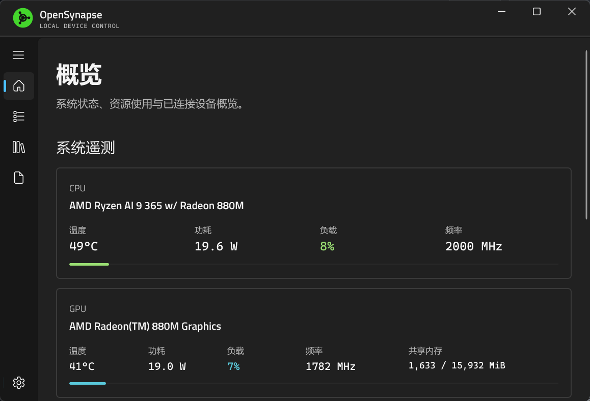
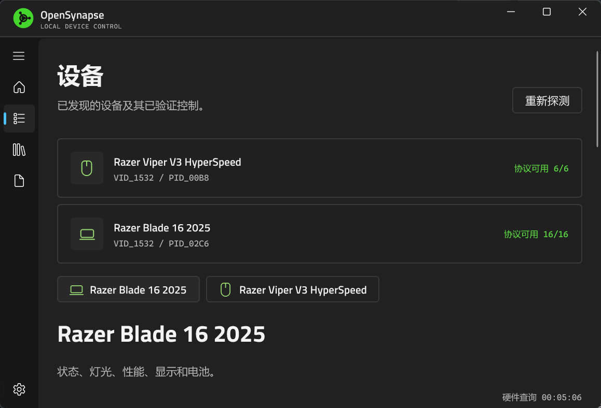
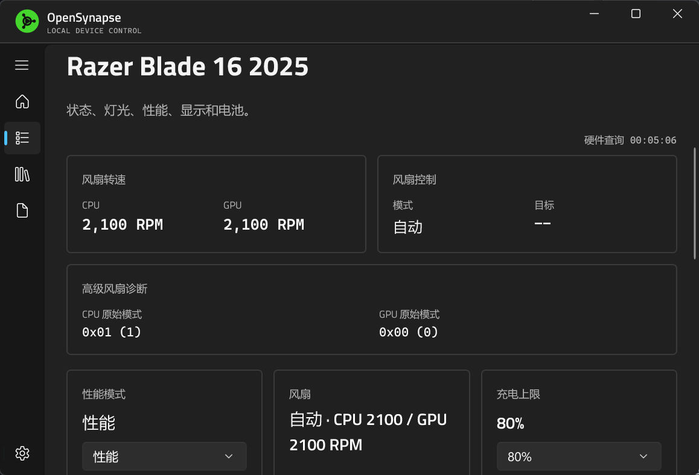
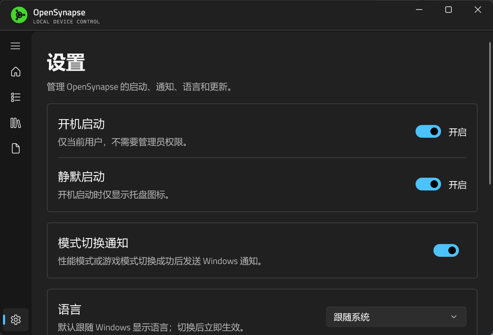

<p align="center">
  
</p>

<h1 align="center">OpenSynapse</h1>

<p align="center">在 Windows 11 上管理受支持的 Razer 硬件，不用让雷云一直留在后台。</p>

<p align="center">
  <a href="https://github.com/A1mAssist/OpenSynapse/releases/latest"></a>
  <a href="LICENSE"></a>
  
</p>

<p align="center">简体中文 · <a href="README.md">English</a></p>

OpenSynapse 会先识别已经连接的设备，再按具体 USB 设备和 HID 端点显示能够确认的控制项。当前支持 254 个 OpenRazer 目录设备，以及 Blade/Viper、Kraken 和 Chroma REST 的专用能力。

> 当前版本 `v1.5.3` · Windows 11 x64 · 未签名

完整版本记录见 [CHANGELOG.md](CHANGELOG.md)。

## 支持范围

OpenSynapse 不只有少数产品专用型号。当前支持 **254 个 OpenRazer 目录设备**，以及 Blade/Viper 产品专用控制、**6 款 Kraken 耳机灯光** 和 Chroma REST 灯光接入。

**[查看完整设备与能力列表](docs/SUPPORTED_DEVICES.zh-CN.md)**，其中包含型号名称、USB PID、产品专用功能以及明确的验证边界。

### 按能力显示控制项

OpenSynapse 会先识别已经连接的设备，再按具体 USB 设备和 HID 端点显示能够确认的控制项。不同型号可能提供设备信息、电池状态、轮询率、DPI 与 DPI 档位、省电设置、灯光、矩阵输出、滚轮设置、键轴优化、Fn 行为或 HyperPolling 接收器控制。

固定 OpenRazer 目录包含 110 个鼠标、72 个键盘、46 个笔记本和 26 个配件。设备出现在目录中，不代表每个控制项都已在该型号上完成真机验证。端点无法解析或正被占用时，页面会保持只读，直到重新扫描；OpenSynapse 不会按产品名称猜测能力，也不会通过未经验证的 HID 接口强行写入。

### 产品专用与附加支持

- **Blade：** 遥测、键盘灯光、性能、风扇、显示、面板模式、支持机型上的局部调光、电池、触控板、充电上限，以及经过验证的 Fn/M3/M4/M5。
- **Blade THX 音频：** 受支持的 Blade 16 和 Blade 14 机型提供空间音频、均衡器预设与频段、人声清晰度和扬声器音量标准化。Blade 设备页会打开可重复使用的 THX 控制窗口。带签名的雷蛇原生组件不随安装包分发；检测到缺失时，会提供经过校验的官方下载。
- **Viper：** 电量、DPI、轮询率、休眠、电池类型和板载映射。
- **Kraken：** 6 款 USB 耳机仅支持灯光；不包含音频、麦克风、EQ 或 THX 控制。

### Chroma REST

参见 [Chroma 支持设备](docs/CHROMA_SUPPORTED_DEVICES.zh-CN.md) 查看当前设备与传输方式矩阵。

兼容的游戏和外部程序可以向 `127.0.0.1:54235` 提交静态、`CUSTOM`、`CUSTOM_KEY` 和 `CUSTOM2` 键盘灯光帧。灯光帧使用经过验证的 Blade 16 实体键位，外部控制结束后会恢复当前选择的灯效。原生 Chroma SDK 和 `RzChromaConnectAPI` DLL 接口尚未实现。

## 界面预览

| 概览 | 设备 |
|---|---|
|  |  |

| Blade 控制 | 设置 |
|---|---|
|  |  |

## 安装

从 [GitHub Releases](https://github.com/A1mAssist/OpenSynapse/releases/latest) 下载其中一种安装文件。

- `OpenSynapse-win-Setup.exe` 安装到当前用户目录并支持自动更新。
- `OpenSynapse-win-Portable.zip` 解压后即可运行。

扫描设备前请先退出 Razer Synapse，避免两个程序争用同一个 HID 端点。OpenSynapse 会报告访问失败，不会自行结束雷云进程。

发布文件没有代码签名，第一次运行时 Windows SmartScreen 可能显示警告。

### 驱动要求

核心设备控制不依赖 Razer Synapse、AppEngine 或 `mapping_engine.dll`。Blade 的 Fn、M3、M4 和 M5 功能仍依赖 Product 710 Razer 设备驱动。THX 音频需要匹配的雷蛇 THX 音频栈，以及 Blade 音频窗口提供的带签名原生组件。

## 当前不包含

- 固件更新、Razer 账号、云服务和 Chroma Studio。
- 高级宏编辑器。
- AMD Curve Optimizer、GPU MUX 和未经验证的硬件写入。
- ARGB Controller，以及缺少 Windows 传输实现的旧式固定报告设备。

## 构建

需要 Windows 11 x64、[.NET 10 SDK](https://dotnet.microsoft.com/download/dotnet/10.0) 和 Windows SDK `10.0.26100`。

```powershell
dotnet restore OpenSynapse.slnx
dotnet build OpenSynapse.slnx -c Release
dotnet test OpenSynapse.slnx -c Release --no-build
dotnet build src/OpenSynapse.App/OpenSynapse.App.csproj -c Release -p:Platform=x64
```

本地构建完成后可以这样启动。

```powershell
& '.\src\OpenSynapse.App\bin\x64\Release\net10.0-windows10.0.26100.0\OpenSynapse.App.exe'
```

## 参与贡献

提交代码或文档前请阅读 [CONTRIBUTING.md](CONTRIBUTING.md)。生成的二进制文件、日志、抓包、逆向工程目录、凭据和本机配置不应进入 Git。

如果需要为新设备补齐支持，请阅读 [设备适配协作指南](docs/DEVICE_ADAPTATION.zh-CN.md)，并使用[设备支持 issue 模板](https://github.com/A1mAssist/OpenSynapse/issues/new?template=device-support.yml)。不要把 Razer 专有文件或用户设备隐私数据上传到公开 issue。

## 许可

OpenSynapse 采用 [MIT License](LICENSE)。第三方组件和随附资源继续遵循各自的许可证与分发条款。

协议实现参考了 [OpenRazer](https://github.com/openrazer/openrazer)、[OpenRGB](https://gitlab.com/CalcProgrammer1/OpenRGB) 及其他公开实现。OpenSynapse 与 Razer Inc. 没有隶属或认可关系，Razer 及相关产品名称是其各自所有者的商标。

Made with ❤ in C# by [A1mAssist](https://github.com/A1mAssist).
